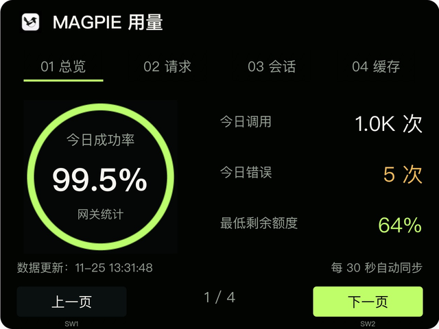

# Magpie 用量 · Hachimo

在 Hachimo 的 640×480 屏幕上查看本机 Magpie 的用量：总览、请求、会话和缓存四页，支持标签和按键翻页。



**数据链路：** 本机 Magpie → Python 采集器（每 15 秒）→ 本地数据文件 → Pet Manager Python 插件（每 30 秒）→ USB → 设备。

这是需要电脑运行的只读组件。缺失指标显示「—」，真实零值保留；采集失败保留上次成功数据和时间，超过 60 秒标记过期，恢复后自动更新。组件保持静音。

## 下载与安装

在 [v1.0.3 Release](https://github.com/songouyang/magpie-usage-hachimo/releases/tag/v1.0.3) 下载：

- `magpie-usage-hachimo-1.0.3.hachiapp`：导入 Pet Manager 的组件包。
- `magpie-collector-1.0.3.zip`：独立采集器，无需安装第三方 Python 依赖。
- `INSTALL.md`：中文安装说明；`SHA256SUMS.txt`：以上三个文件的 SHA-256 校验和。

要求 macOS、Python 3.9+、运行中的 Magpie，以及支持 `petui-python-v1` 的 Pet Manager。可用 `~/.claw-pet/authoring/petui tool-info` 检查客户端是否报告 `pythonPlugin: "petui-python-v1"`。

1. 保持 Magpie 运行，默认地址为 `http://127.0.0.1:3425`。
2. 解压采集器 ZIP，进入解压出的 `collector` 目录，执行 `python3 -m magpie_usage`。macOS 也可双击 `start-collector.command`。启动后生成 `data/magpie-usage.txt`。
3. 在 Pet Manager「组件中心 → 导入组件」选择 `.hachiapp`，打开「我的组件」中的「Magpie 用量」。
4. 在详情的「Python 数据插件」选择采集器生成的 `magpie-usage.txt` 并授权，等待数据可用。
5. 连接设备 USB，点击「保存并同步」，等待安装完成，再在设备打开组件。保持采集器和 Pet Manager 运行。

默认 SW1／摇杆向左为上一页，SW2／摇杆向右为下一页。可点总览、请求、会话、缓存标签；键位提示跟随实际绑定，退出跟随设备全局设置。升级沿用组件 ID `magpie-usage-hachimo`，需要重新授权插件并保存同步。

## 采集器参数与故障处理

在 `collector` 目录执行：

```sh
python3 -m magpie_usage --magpie-url http://127.0.0.1:3425
python3 -m magpie_usage --feed-file /absolute/path/magpie-usage.txt
python3 -m magpie_usage --once
python3 -m magpie_usage --local-only --once
python3 -m magpie_usage --output ./snapshot.json
```

`--once` 只采集一轮，成功退出码为 0，失败为 1。`--local-only` 不写插件数据文件，仍可更新成功缓存；`--output` 输出诊断 JSON。停止采集器用 Control-C，不提供开机自启。详细参数和指标口径见 [采集器说明](collector/README.md)。

显示等待时，检查 Magpie、数据文件选择及插件授权。显示过期时，检查采集器和 Magpie 是否继续运行。设备更新还需要 Pet Manager 保持运行、USB 已连接及组件完成同步。当前链路按 Pico USB 验证；其他设备通过原生同步流程检查兼容性。

数据文件固定为 8192 字节，采用两个 4096 字节槽，交替原位写入并校验。不要用编辑器保存、移动或复制覆盖正在授权的文件；文件被替换后须重启采集器并重新选择授权。进程锁和数据文件锁阻止冲突写入。缓存、诊断和数据文件可能包含个人用量，请勿分享。

## 从源码构建

仓库包含当前组件的清单和素材、采集器、共享协议与展示逻辑、测试及构建工具。单文件 `pc/plugin.py` 在临时目录生成，打包产物不进入 Git。

安装支持 Python 插件的 Pet Manager，并进入组件中心使官方 PetUI 工具可用，然后在仓库根目录执行：

```sh
PYTHONPATH=collector python3 -m unittest discover -s collector/tests -v
python3 tools/build_release.py
python3 tools/verify_release.py
cd delivery
shasum -a 256 -c SHA256SUMS.txt
```

输出目录默认为 `delivery`。两个工具均支持 `--output-dir /path/to/output` 和 `--petui /path/to/petui`，也可用 `PETUI` 环境变量指定工具入口。版本从 `component.json` 读取。构建依赖 Python 标准库和官方 PetUI，不需要固件或客户端源码。

## 验证与来源

自动测试覆盖指标口径、缺失／零值、失败／过期／恢复、双槽半写入、锁、文件身份、插件输出及四页绑定。Release 验证使用无隐私样例运行官方 MicroPython 预览，并验证解压后的采集器和校验和。已完成和未完成的设备项目见 [验证说明](docs/verification.md)。

接口和部分指标计算源自 MIT 项目 [magpie-usage-display](https://github.com/peterroe/magpie-usage-display)。组件使用 [HachimoDock](https://github.com/ai-maker-lab/HachimoDock) 的公开 PetUI 能力。许可证见 [LICENSE](LICENSE)，归属说明见 [THIRD_PARTY_NOTICES.md](THIRD_PARTY_NOTICES.md)。
